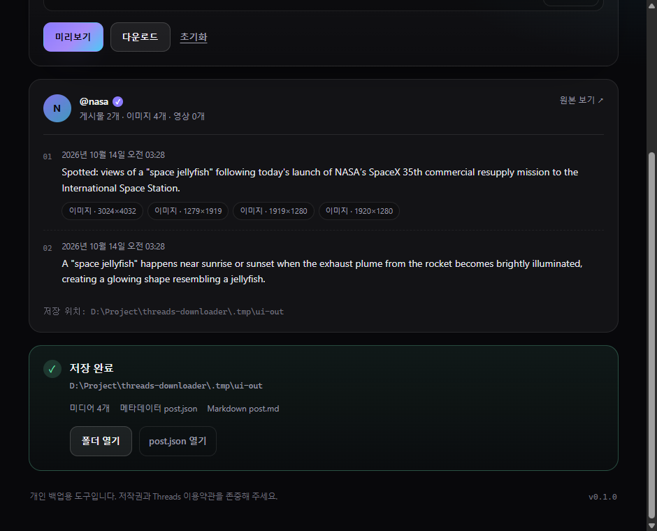

# Threads Archiver

Threads 게시물 링크 하나로 사진·영상·글(작성자가 이어 쓴 연속 게시물 포함)을 내 컴퓨터에 저장하는 개인 백업용 데스크톱 앱입니다.



## 설치 (Windows)

[Releases](https://github.com/jeiel85/threads-archiver/releases/latest)에서 `Threads Archiver_<버전>_x64-setup.exe`를 받아 실행하면 됩니다. 관리자 권한 없이 사용자 계정에 설치되고, 시작 메뉴에 등록됩니다.

- Node.js나 별도 브라우저를 설치할 필요가 없습니다. 엔진과 Node 런타임이 설치본에 들어 있고, 게시물은 Windows에 기본 탑재된 **Microsoft Edge**로 엽니다(창은 뜨지 않습니다).
- 코드 서명이 없는 설치본이라 처음 실행할 때 SmartScreen 경고가 뜰 수 있습니다. **추가 정보 → 실행**을 누르세요.
- 지원 환경은 Windows 10/11 x64입니다. 클립보드 감시·시작 프로그램 등록은 Windows 전용입니다.
- **자동 업데이트**: 앱을 켤 때 GitHub 최신 릴리스를 확인해, 새 버전이 있으면 창 하단에 **업데이트** 버튼이 나타납니다. 누르면 설치본을 받아 서명을 검증한 뒤 설치하고 앱을 다시 실행합니다. 하단의 **업데이트 확인**으로 직접 확인할 수도 있습니다. v0.4.0 이하(이 PC 전용 exe)는 자동 업데이트가 없으니 설치본을 한 번 직접 설치하세요.

## 구성

| 경로 | 내용 |
| --- | --- |
| `packages/core` | 추출·다운로드 엔진. Playwright(Chromium 또는 Edge)로 게시물 페이지를 열어 글과 미디어를 수집합니다. CLI와 로컬 HTTP 엔진 서버를 함께 제공합니다. |
| `apps/desktop` | Tauri 2 + React 데스크톱 앱. 실행 시 Node로 엔진 서버(`server.js`)를 띄우고, 무작위 토큰을 붙여 `127.0.0.1`로만 통신합니다. |
| `scripts/install-browser.mjs` | Playwright용 Chromium 설치(선택, 약 150MB) |
| `scripts/stage-bundle.mjs` | 설치본에 넣을 엔진·Node 런타임 준비(`npm run bundle`에서 실행) |
| `scripts/smoke.mjs` | 실제 게시물로 엔진 → 미리보기 → 다운로드 전 과정을 확인하는 스모크 테스트 |

## 소스에서 빌드하기

### 요구 사항

- Node.js 20.11 이상
- Rust 툴체인과 [Tauri 2 사전 요구 사항](https://tauri.app/start/prerequisites/) (Windows: Microsoft C++ Build Tools, WebView2)

```bash
git clone https://github.com/jeiel85/threads-archiver.git
cd threads-archiver
npm ci
npm run setup:browser   # 선택: Playwright Chromium 설치. 없으면 시스템 Edge(macOS·Linux는 Chrome)를 씁니다.
```

### 설치본 만들기

```bash
npm run bundle
```

`apps/desktop/src-tauri/target/release/bundle/nsis/`에 `*-setup.exe`가 생깁니다. 빌드 과정에서 `scripts/stage-bundle.mjs`가 엔진(`packages/core/dist`), `playwright` 패키지, **빌드에 쓴 Node 실행 파일**을 `src-tauri/bundle-resources/`에 모아 설치본에 넣습니다. Chromium은 넣지 않습니다.

`v*` 태그를 올리면 GitHub Actions(`.github/workflows/release.yml`)가 같은 과정으로 설치본을 만들고, 업데이트 서명(`.sig`)과 `latest.json`을 생성해 릴리스에 첨부합니다. 서명 키는 저장소 Secret(`TAURI_SIGNING_PRIVATE_KEY`, `TAURI_SIGNING_PRIVATE_KEY_PASSWORD`)에 있고, 공개 키는 `tauri.conf.json`의 `plugins.updater.pubkey`입니다. 키를 잃으면 이미 설치된 앱이 새 버전을 받지 못하므로 키 백업을 유지하세요. 직접 빌드한 설치본(`npm run bundle`)은 서명 없이 만들어지며 자동 업데이트 확인은 공식 릴리스를 바라봅니다.

설치 없이 이 PC에서만 쓸 실행 파일이 필요하면 `npm run tauri -w @threads-archiver/desktop -- build --no-bundle`로 만들 수 있습니다. 이 exe는 빌드한 저장소 경로의 `packages/core/dist/server.js`와 PATH의 `node`를 쓰므로 다른 PC로 옮기면 동작하지 않습니다.

### 데스크톱 앱 (개발 모드)

```bash
npm run tauri -w @threads-archiver/desktop -- dev
```

링크를 붙여 넣고 **미리보기**로 글과 미디어 썸네일을 확인한 뒤 **다운로드**를 누르면 됩니다. 저장 폴더(기본 `<홈>\Downloads\Threads Archiver`) 아래에 게시물마다 하위 폴더를 만들어 저장합니다.

```
Threads Archiver/
  2026-10-14 @nasa - Spotted views of a space jellyfish…/
  2026-10-13 @zuck - Introducing Muse Wonder, our new family…/
```

폴더 이름은 `<작성일> @<작성자> - <본문 첫 줄 요약>`이라 이름순 정렬이 곧 시간순입니다. 본문이 없으면 게시물 ID를 쓰고, 같은 이름의 다른 게시물이 있으면 ` (2)`처럼 번호를 붙입니다. 같은 게시물을 다시 받으면 기존 폴더를 덮어씁니다.

### 클립보드 감시 · 트레이

- **클립보드 감시**(기본 꺼짐): Threads 게시물·공유 링크를 복사하면 화면 우측 하단에 알림이 뜨고, **다운로드**를 누르면 기본 저장 폴더(`Downloads\Threads Archiver`) 아래 게시물 폴더에 바로 저장합니다. 이미 받은 게시물이면 같은 폴더에 다시 저장했다고 알려 줍니다.
  - **자동 다운로드**(기본 꺼짐, 클립보드 감시를 켰을 때만): 알림이 5초 카운트다운 뒤 스스로 다운로드합니다. 그 전에 **다운로드 하지 않기**(또는 ×)를 누르면 취소되고, 알림에 마우스를 올려 두면 카운트다운이 멈춥니다. **지금 다운로드**로 바로 받을 수도 있습니다.
  - 클립보드 변경 번호만 0.5초마다 비교하고, 바뀌었을 때만 텍스트를 읽어 Threads 링크인지 확인합니다. 내용은 저장하거나 보내지 않습니다.
  - 감시를 켜기 전에 이미 복사돼 있던 링크와, 이번 실행에서 이미 알린 링크에는 다시 반응하지 않습니다.
  - 갤럭시 폰은 **Windows와 연결(Link to Windows)** 앱에서 클립보드 동기화를 켜면 폰에서 복사한 링크도 감지됩니다. 아이폰은 Windows와 클립보드를 동기화하는 공식 방법이 없어 지원하지 않습니다.
  - **연속으로 여러 건**: 받는 중에 다른 링크를 복사해도 앞의 다운로드는 끊기지 않습니다. 알림은 새 링크를 먼저 묻고("앞의 다운로드 N건은 계속 받고 있어요"), 받기로 한 링크는 차례로 대기열에 들어갑니다. 모두 끝나면 `2건 저장 · 1건 실패`처럼 한 번에 요약합니다.
- **다운로드 내역**: 메인 창 아래에 메인 창·알림에서 받은 모든 작업이 최근 순으로 쌓입니다. 진행 중인 항목은 진행률과 **취소**, 끝난 항목은 **폴더 열기**와 **다시 받기**를 할 수 있습니다. 내역은 `%LOCALAPPDATA%\Threads Archiver\history.json`에 최근 200건까지 남고, 앱이 꺼질 때 받던 항목은 "중단됨"으로 바뀌어 다시 받을 수 있습니다.
- **Threads 로그인**: "일부 사용자에게만 공개된" 게시물처럼 로그인해야 보이는 글은 `로그인해야 볼 수 있는 게시물입니다`로 알려 줍니다. 설정의 **Threads 로그인**을 누르면 브라우저가 열리고, 로그인하면 창이 저절로 닫히며 세션이 이 PC에 저장되어 이후 다운로드에 쓰입니다. 버튼 옆에 `● 로그인됨` / `○ 로그인 안 됨`이 표시되고, 다운로드할 때마다 세션이 살아 있는지 다시 확인합니다.
- **진행률**: 알림 창과 메인 창에 받은 용량(`5.6 / 8.1MB`)과 %가 표시됩니다. 받는 중 알림 창의 `–`(숨기기)를 눌러도 다운로드는 계속되며, 트레이 아이콘에 마우스를 올리면 진행률이 보이고 클릭하면 진행 창이 다시 뜹니다.
- **트레이**: 창을 닫으면 트레이로 내려가 계속 실행됩니다. 트레이 메뉴에서 열기 · 클립보드 감시 켜기/끄기 · 종료를 할 수 있습니다. 이미 실행 중일 때 다시 실행하면 기존 창이 열립니다.
- **Windows 시작 시 트레이로 실행**(기본 꺼짐): 켜면 `HKCU\…\Run`에 `--minimized` 인자로 등록되어 로그인 시 창 없이 트레이에서 시작합니다.

### CLI

```bash
npm run build -w @threads-archiver/core
node packages/core/dist/cli.js "https://www.threads.com/@nasa/post/Decc755lYhC"
```

주요 옵션은 `-o <상위 폴더>`, `--no-media`, `--no-markdown`, `--json`, `--headed`, `--login`입니다. 전체 목록은 `--help`로 확인하세요.
로그인이 필요한 게시물은 `--login`으로 브라우저를 열어 로그인해 두면, 세션이 `%LOCALAPPDATA%\Threads Archiver\browser-profile`에 저장되어 이후 실행에 쓰입니다.

## 저장 결과

```
<저장 폴더>/<작성일> @<작성자> - <요약>/
  01.jpg, 02.mp4, …   # 미디어 (게시물 순서대로 번호)
  post.json           # 작성자·게시물·미디어 메타데이터 전체
  post.md             # 사람이 읽기 좋은 Markdown 요약
```

## 개발

```bash
npm test            # core 단위 테스트 (vitest)
npm run typecheck   # 전체 워크스페이스 타입 검사
node scripts/smoke.mjs [threads-url] [baseDir]  # 네트워크·브라우저 필요
```

미리보기 썸네일은 원본을 받지 않습니다. 이미지는 CDN이 제공하는 320px급 축소본을 쓰고, 영상은 추출에 쓴 브라우저에서 약 1초 지점 한 장면을 360px JPEG(수~수십 KB)로 찍습니다. 썸네일을 만들지 못한 미디어는 종류·해상도만 표시합니다. 영상 캡처는 `post.json`에 저장하지 않습니다.

## 현재 한계

- 설치본은 Windows x64만 제공합니다. macOS·Linux는 소스에서 개발 모드로 실행할 수 있지만 검증하지 않았습니다.
- 브라우저는 Playwright Chromium이 설치돼 있으면 그것을, 없으면 Edge를 씁니다. `THREADS_ARCHIVER_BROWSER_CHANNEL`(예: `msedge`, `chrome`) 환경 변수로 강제할 수 있습니다.
- Threads 페이지 구조가 바뀌면 추출이 깨질 수 있습니다. `scripts/smoke.mjs`로 주기적으로 확인하세요.

## 주의

개인 백업용 도구입니다. 저작권과 Threads 이용약관을 존중해 주세요.
